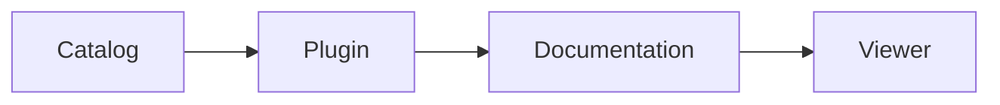

# Lifecycle demo

Public acceptance fixture for BYH catalog loading. Version 2.0.2.
The plugin runtime is unchanged except for its displayed version.

The catalog contains one installable plugin and 99 deliberately unavailable
network sentinels. Do not install the sentinels: they verify that browsing and
searching a catalog does not request every recommended repository.

## Four image requests

## Diagram

