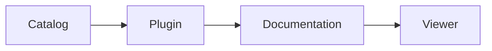

# Lifecycle demo

Public installation and documentation-viewer fixture for Build Your Harness.
Version 2.0.1. The plugin code is unchanged except for its displayed version.

## Image preview

Open this package image in a viewer tab and reopen BYH to check restoration.

## Diagram

About this check

This public test plugin has no backend or external service. Images use the host documentation loader.

[Change notes](CHANGELOG.md)
